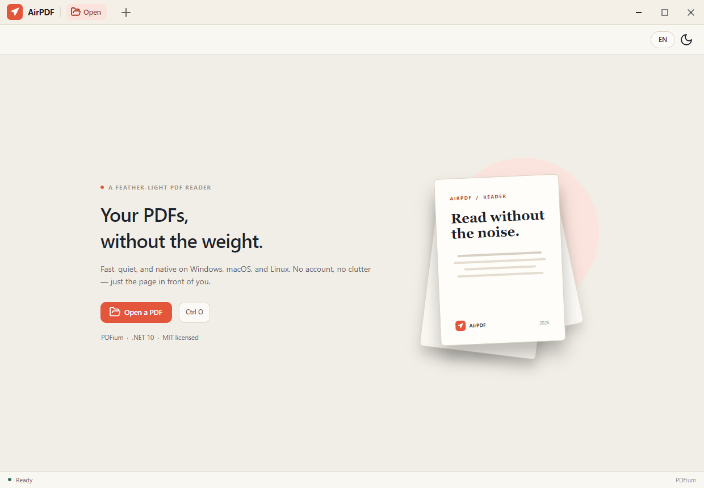
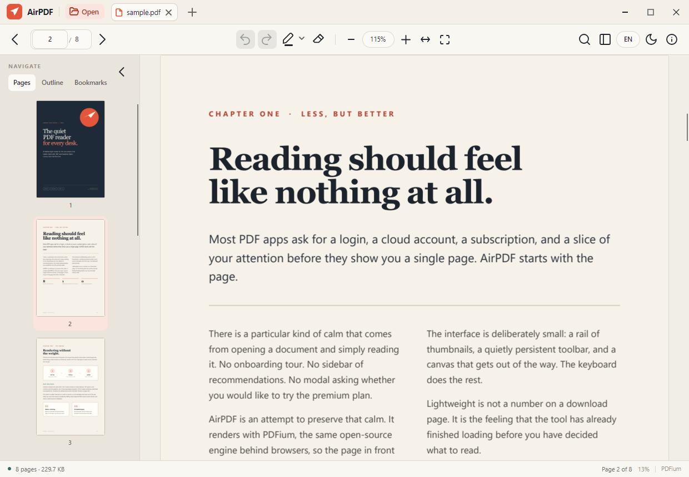
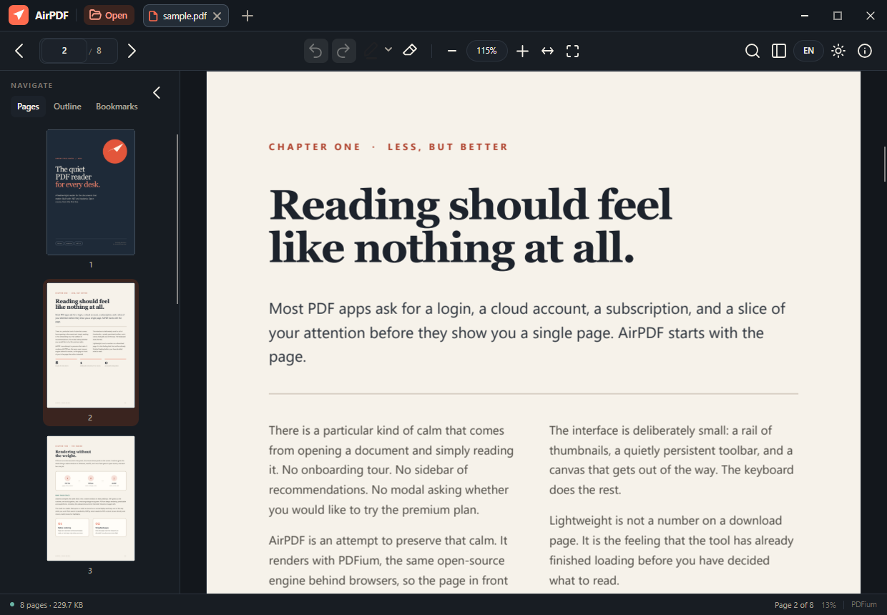
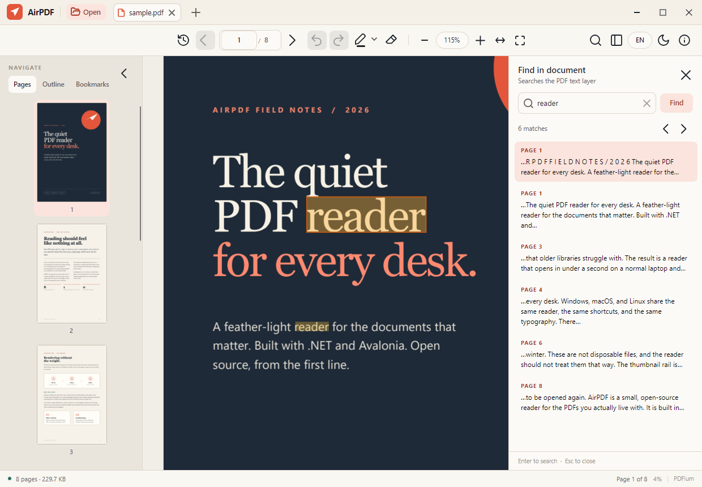

<p align="center">
  <strong>English</strong> &nbsp;·&nbsp; <a href="README.zh-CN.md">简体中文</a>
</p>

<p align="center">
  
</p>

<h1 align="center">AirPDF</h1>

<p align="center">
  A feather-light, cross-platform PDF reader built with .NET and Avalonia.
</p>

<p align="center">
  <a href="https://apps.microsoft.com/detail/9pnsx3223qh1"><strong>Microsoft Store</strong></a>
  &nbsp;·&nbsp;
  <a href="https://github.com/RyzenWang/AirPDF/releases/latest">Latest releases</a>
</p>

<p align="center">
  <a href="https://github.com/RyzenWang/AirPDF/actions/workflows/ci.yml">
    
  </a>
  
  
  
  
</p>

AirPDF opens PDFs quickly, renders them natively, and stays out of the way. It
has no account, no cloud, no telemetry, and no web view. The whole reader is a
small .NET application with a hand-built Avalonia interface.

> **Status:** 0.7.0. Windows builds are available from the
> [Microsoft Store](https://apps.microsoft.com/detail/9pnsx3223qh1) and
> [GitHub Releases](https://github.com/RyzenWang/AirPDF/releases/latest); macOS and Linux
> ship as portable archives. The Store listing can trail the GitHub release. Highlights,
> ink, notes, bookmarks, tabs, a custom Windows titlebar, undo/redo, and saving are in;
> printing is not. See the [roadmap](#roadmap).

---

## Screenshots

| Reading, light | Reading, dark |
| --- | --- |
|  |  |



The Windows screenshots show the 0.6 titlebar, where the document tabs and window controls
share the top row. macOS and Linux keep their native window frame and the tab bar below it.

## Features

- **Native PDFium rendering** at the exact display scale, with high-DPI support.
- **Continuous, virtualized pages** — only pages near the viewport are decoded. Visible pages
  render before thumbnails, bitmaps are bounded by count and memory, and closing a tab
  releases its PDFium session off the UI thread.
- **Windows titlebar, with the tabs in it** — on Windows the 44px workspace bar also carries
  the window controls. Brand, Open, document tabs and minimize/maximize/close share one row;
  the toolbar below is unchanged. Drag the empty area to move the window, double-click it to
  maximize, and hover the maximize button for Windows 11 Snap Layouts. In fullscreen the
  maximize control becomes an exit-fullscreen button, and the top edge also starts a drag
  and leaves fullscreen instead of hitting a resize border. Exiting restores the previous
  normal or maximized state. Entering fullscreen shows a short top-centre hint with the
  exit shortcuts and button. Right-click the empty titlebar area or press `Alt+Space` for
  the native window menu, and the window buttons dim while the window is inactive. macOS
  and Linux keep their native window frame.
- **Page navigation on the left** — previous/next and the current-page box sit at the far
  left of the toolbar, aligned with the thumbnail rail; editing and zoom tools stay centred.
- **Thumbnail rail and document outline** for fast navigation.
- **Full-text search** with page-grouped results, in-page match highlights, and progress
  while a long document is scanned.
- **Text selection and copy** — drag across text and pages, double-click a
  word, `Ctrl+A` selects the document (up to 1,000 pages), and `Ctrl+C` copies the result.
- **Remembers your place** in every document, including the offset within the
  page; the position is restored on the next open.
- **Remembers your zoom** too — fit width, fit page, or an exact factor, per
  document.
- **Zoom** with fit width, fit page, actual size, presets, and `Ctrl` + wheel.
- **Password-protected PDFs** with a proper unlock prompt.
- **Light, dark, and high-contrast themes**, following the system on first launch.
- **Status bar** with the page position and a reading-progress percentage.
- **Highlights, ink, and notes** — select text and press `Ctrl+Shift+H` to highlight it, or pick a
  colour under **Highlight** in the page menu, which highlights it as you choose. Turn on drawing
  with `Ctrl+Shift+K` or the pen button and write on the page; the arrow beside the pen opens the
  ink colours and the thickness slider, which previews the stroke it will draw. Sticky notes come
  from the page menu, and a highlight can be removed from it too.
  Every markup change can be undone and redone, from the toolbar or with `Ctrl+Z` and `Ctrl+Y`
  (the last 100 steps are kept), and `Ctrl+S` writes them into the document itself.
- **Per-document bookmarks** — `Ctrl+D` marks the current spot and the sidebar keeps them
  per file. Double-click one to rename it, drag them into the order you want, and the
  welcome screen lists bookmarks from every document so you can jump straight back in.
- **Links** — internal destinations jump to their page, `http`/`https`/`mailto`
  links open in your browser or mail client, and the cursor turns into a hand.
- **Multiple windows** (`Ctrl+N`, or open the current file in a new window) sharing
  one settings store, theme, and language.
- **System tray** — the AirPDF tray icon restores a hidden window; its menu can hide all
  windows, open a new window, or exit. Closing a window still exits the app; choose
  **Hide to tray** to keep documents open. On Linux, tray support depends on
  StatusNotifier/AppIndicator availability.
- **Tabs keep the whole document session** — `Ctrl+T` adds a document to the same window,
  and each tab keeps its own zoom, scroll position, search results, and reading position.
  The active tab is a warm pill, the strip scrolls when it runs out of room, and `+` follows
  the last tab before pinning to the visible edge. Drag tabs to reorder them; holding one
  near either edge scrolls a long strip, and tabs slide into their new positions. Right-click
  a tab to close it or close every other tab. The brand block is Home; there is no separate
  visible Home tab.
- **NativeAOT** — every release is compiled ahead of time, so the
  window appears in well under a second instead of several.
- **Back navigation** with `Alt+Left` after any outline, thumbnail, search, or
  page jump.
- **Right-click menu** for copy, select all, and showing the file in the folder.
- **Accessible controls** — toolbar buttons, inputs, and lists expose names to
  screen readers.
- **English by default, Simplified Chinese on demand** — switch live from the
  toolbar or with `Ctrl+Shift+L`.
- **Drag and drop**, command-line opening, and a recent-files shelf.
- **Automatic updates** in installed Velopack builds: they check GitHub, download in the
  background, and offer a restart. Microsoft Store builds update through the Store; portable
  and source builds do not self-update.
- **Keyboard-first navigation** and a quiet, information-dense status bar.
- **No network access on the reading path**; installed Velopack builds only contact
  GitHub when checking for updates.

## Tech stack

| Layer | Choice | Why |
| --- | --- | --- |
| Runtime | .NET 10 (LTS) | One modern runtime for Windows, macOS, and Linux. |
| UI | Avalonia 11 | Native desktop windows from a single XAML codebase. |
| Window chrome | Avalonia + `Win32Properties` | The Windows tab bar doubles as a managed titlebar; `HTMAXBUTTON` restores Windows 11 Snap Layouts. macOS and Linux keep native decorations. |
| Rendering | PDFium | The same open-source engine used by browsers; one document handle stays open while reading. |
| Raster transport | SkiaSharp | Fast, predictable pixel handling. |
| Text layer | PDFium (`FPDFText_*`) | Characters arrive in reading order from the engine that renders the page, so search, selection, and rotated pages agree with what is drawn. PDFium also supplies metadata and the outline, loaded only when the reader opens those panels. |
| MVVM | CommunityToolkit.Mvvm | Small, source-generated, no framework lock-in. |
| Compilation | NativeAOT (Windows, Linux, macOS) | No JIT at startup: measured 0.7 s to first window against 5.0 s on Windows. |

## Requirements

- [.NET 10 SDK](https://dotnet.microsoft.com/download) for building.
- Windows 10/11, macOS 13+, or a modern Linux desktop (X11 or Wayland). Windows 11 is
  required for Snap Layouts from the custom maximize button; Windows 10 uses the same
  titlebar without the Snap flyout.
- On Linux, the usual Avalonia desktop dependencies (X11/Wayland, fontconfig,
  and OpenGL or a software renderer) must be installed. Rendering uses the
  fontconfig-enabled SkiaSharp build, so system fonts are required. Install a CJK
  font such as `fonts-noto-cjk` to read Chinese or Japanese documents.

The published builds are self-contained; end users do not need .NET installed.

The Linux build is produced on Ubuntu 22.04 and therefore needs glibc 2.35 or newer
(Ubuntu 22.04+, Debian 12+). NativeAOT links against the build machine's glibc, so an
older distribution will refuse to start the binary.
Building the NativeAOT release additionally needs a C++ toolchain: the MSVC build tools
and the Windows SDK on Windows, Xcode on macOS, clang on Linux. A plain `dotnet build`
does not.

## Run from source

```bash
git clone https://github.com/RyzenWang/AirPDF.git
cd AirPDF
dotnet run --project src/AirPdf.App
```

Open a PDF with the **Open** button, drag one onto the window, or pass a path:

```bash
dotnet run --project src/AirPdf.App -- /path/to/document.pdf
```

## Build and test

```bash
dotnet restore AirPdf.sln
dotnet build AirPdf.sln -c Release
dotnet test AirPdf.sln -c Release
```

The suite currently has **282 tests** (121 Core, 161 App). It uses
`tests/Assets/sample.pdf`, an eight-page document that exercises Latin and Chinese text,
mixed typography, and search geometry. `AirPdf.App.Tests` adds headless Avalonia coverage
for the XAML and tab strip, opening, search, selection, zoom, language switching,
reading-position restore, and the Windows Snap Layout hit-test marker.

## Publish

Framework-dependent build:

```bash
dotnet publish src/AirPdf.App -c Release -r linux-x64 --self-contained false
```

Self-contained single file:

```bash
dotnet publish src/AirPdf.App -c Release -r win-x64 \
  --self-contained true \
  -p:PublishSingleFile=true \
  -p:IncludeNativeLibrariesForSelfExtract=true \
  -p:EnableCompressionInSingleFile=true
```

NativeAOT, which is what every release ships:

```bash
dotnet publish src/AirPdf.App -c Release -r win-x64 `
  -p:PublishAot=true `
  -p:StripSymbols=true
```

Supported runtime identifiers include `win-x64`, `win-arm64`, `linux-x64`,
`linux-arm64`, `osx-x64`, and `osx-arm64`.

### Packages, installers, and automatic updates

Tagged releases are packaged with [Velopack](https://velopack.io/):

- **Windows x64: [Microsoft Store](https://apps.microsoft.com/detail/9pnsx3223qh1)** — recommended,
  and updates arrive through the Store
- Windows x64 portable: `AirPDF-win-Portable.zip` — unzip anywhere and run `AirPdf.exe`
- macOS arm64 / x64: `AirPDF-osx-*-Portable.zip` — unzip and drag `AirPDF.app` to Applications
- Linux x64: portable `.tar.gz`

**The installers are not published yet.** The builds are unsigned, so `Setup.exe` and the
`.pkg` would be stopped by SmartScreen and Gatekeeper on first launch, and that reads as a fault
in the reader rather than in its distribution. The portable archives stay available; the first
launch may still need *More info → Run anyway* on Windows, or right-click → *Open* on macOS.
The installers return once a signing certificate is configured.

Installed Velopack builds check GitHub for a newer stable release, download it in the
background, and show a **Restart to update** action. Microsoft Store builds update through
the Store. Portable and source builds do not self-update.

The workflow also contains optional Windows code-signing and macOS
codesign/notarization steps. See [docs/SIGNING.md](docs/SIGNING.md) for how to
obtain the certificates and store them as secrets, and
[docs/DISTRIBUTION.md](docs/DISTRIBUTION.md) for the exact release process.

`packaging/signing/Set-SigningSecrets.ps1` validates a certificate and uploads
it. The **Signing check** workflow verifies the configuration without publishing
anything, and passes once the certificates are in place:

```bash
gh workflow run signing-check.yml --repo RyzenWang/AirPDF
```

> Release binaries are currently unsigned. Windows SmartScreen and macOS
> Gatekeeper may ask for confirmation until signing is added.

## Keyboard shortcuts

| Shortcut | Action |
| --- | --- |
| `Ctrl+O` / `Cmd+O` | Open a PDF |
| `Ctrl+W` / `Cmd+W` | Close the tab (asks before discarding unsaved markup) |
| `Ctrl+N` / `Cmd+N` | Open a new window |
| `Ctrl+T` / `Cmd+T` | Open a new tab |
| `Ctrl+Tab` / `Ctrl+Shift+Tab` | Next / previous tab |
| `Ctrl+F` / `Cmd+F` | Find in document |
| `Ctrl+D` / `Cmd+D` | Add a bookmark at the current position |
| `Ctrl+Shift+H` / `Cmd+Shift+H` | Highlight the selected text |
| `Ctrl+Shift+K` / `Cmd+Shift+K` | Turn drawing on or off (freehand ink) |
| `Ctrl+S` / `Cmd+S` | Save the document, highlights included |
| `Ctrl+Shift+S` / `Cmd+Shift+S` | Save as… |
| `Ctrl+Z` / `Cmd+Z` | Undo the last markup change (last 100 steps are kept) |
| `Ctrl+Y` / `Cmd+Y` | Redo |
| `F3` / `Shift+F3` | Next / previous search match |
| `Alt+Left` | Return to the previous position |
| `Alt+Space` | Open the window system menu (Windows) |
| Drag on text | Select characters |
| Double-click | Select a word |
| `Ctrl+C` / `Cmd+C` | Copy the selected text |
| `Ctrl+A` / `Cmd+A` | Select all document text (up to 1,000 pages) |
| `Enter` | Jump to the typed page, or run a search |
| `Esc` | Leave drawing or erasing mode, clear the selection, close search, dismiss an error, or leave full screen |
| `Ctrl++` / `Ctrl+-` | Zoom in / out |
| `Ctrl+0` | Fit page |
| `Ctrl+1` | Actual size |
| `Ctrl+2` | Fit width |
| `Ctrl` + wheel | Zoom |
| `Ctrl+Shift+L` | Toggle English / 简体中文 |
| `F11` | Toggle full screen |
| `↑` / `↓` | Scroll up or down a step |
| `Page Up` / `Page Down` | Scroll up or down a screen |
| `Home` / `End` | Jump to the start or the end of the document |

Right-clicking the page canvas opens a menu for copying the selection, selecting
the whole document, and showing the file in its folder.

## Architecture

```
┌─────────────────────────────┐
│ AirPdf.App (Avalonia)       │
│  views · view models        │
│  bitmap conversion · input  │
└──────────────┬──────────────┘
               │
┌──────────────▼──────────────┐
│ AirPdf.Core                 │
│  PdfDocumentService         │  PDFium
│  PdfSearchService           │  PDFium text layer
│  SettingsService            │  JSON in the user profile
└─────────────────────────────┘
```

- `AirPdf.Core` has no Avalonia dependency and can be reused by a CLI, tests,
  or another front end.
- PDFium is single-threaded by design, so all native calls are serialized
  through one process-wide priority gate.
- Pages are rendered to `WriteableBitmap` objects, reused through a small
  generation-scoped pool, and evicted when they move outside a small window
  around the current page.
- The page list is a virtualizing `ListBox` with a custom template; the scroll
  position drives current-page detection and thumbnail selection.
- On Windows, `SystemDecorations.BorderOnly` plus an extended client area replace
  the non-client caption with the existing top bar. The maximize button is exposed
  as `HTMAXBUTTON`, and a small `WM_NCMOUSEMOVE` hook keeps its hover state while
  Windows 11 handles Snap Layouts. Right-clicking the caption strip or pressing `Alt+Space`
  opens the native system menu through `GetSystemMenu`/`TrackPopupMenu`, and the
  `Activated`/`Deactivated` events drive caption opacity. Other platforms leave window
  chrome alone.
- Search reads the PDF text layer once, groups matches by page, and maps word
  bounding boxes back to normalized overlay rectangles.

More detail: [docs/ARCHITECTURE.md](docs/ARCHITECTURE.md).

## Project layout

```
src/
  AirPdf.Core/          PDF services, models, settings
  AirPdf.App/           Avalonia desktop application
tests/
  AirPdf.Core.Tests/    Open, render, search, and failure tests
  AirPdf.App.Tests/     Headless view-model and page-layout tests
  Assets/               Reproducible sample PDF and its HTML source
docs/                   Screenshots and architecture notes
```

## Limitations

- No form filling, printing, or PDF text editing.
- Only `http`, `https`, and `mailto` link targets are followed; `Launch` and
  remote-`GoTo` actions are ignored so a document cannot start a program.
- Tabs are document sessions. The brand block returns to Home and is not a separate tab;
  closing the last document tab returns to Home. `Ctrl+W` asks before discarding unsaved
  markup.
- Windows 11 Snap Layouts are supported; Windows 10 has the same custom buttons but no Snap
  flyout.
- Custom titlebar integration is Windows-only. macOS and Linux keep their native
  decorations and place the tab bar below them.
- Release binaries are signed only when the maintainer signing secrets are
  configured. Unsigned Windows/macOS builds may show platform warnings.
- Mobile and browser targets are out of scope for the desktop reader.

## Roadmap

- [x] PDF hyperlinks and internal link navigation
- [ ] Native printing and "Save a copy"
- [x] Per-document bookmarks
- [x] Rotated pages (links, search highlights, text selection)
- [x] Highlight annotations, saved with "Save a copy"
- [x] Ink and sticky-note annotations
- [x] Multiple windows
- [x] Tabs
- [x] Unified tab/title bar with Windows 11 Snap Layouts
- [x] Windows titlebar system menu and inactive caption states
- [ ] Additional UI languages (English and Simplified Chinese are available)
- [ ] Configure production Windows signing and Apple notarization credentials
- [x] NativeAOT (Windows, Linux, and macOS)
- [x] UI/end-to-end coverage for zoom, search, language switching, and updates
- [ ] OCR for scanned PDFs, so pages that are only page images can be selected and
  searched. Today such a document has no text layer at all, and selection and search
  silently find nothing.

Contributions and issue reports are welcome. If you want to pick up a roadmap
item, open an issue first so we can keep the design coherent.

## Contributing

Read [CONTRIBUTING.md](CONTRIBUTING.md) before opening a pull request. The
project follows the [Contributor Covenant](CODE_OF_CONDUCT.md). Security issues
should follow [SECURITY.md](SECURITY.md), not the public issue tracker.

## License

AirPDF is released under the [MIT License](LICENSE). Third-party components and
their licenses are listed in [THIRD-PARTY-NOTICES.md](THIRD-PARTY-NOTICES.md).

---

<sub>Also available in [简体中文](README.zh-CN.md).</sub>
