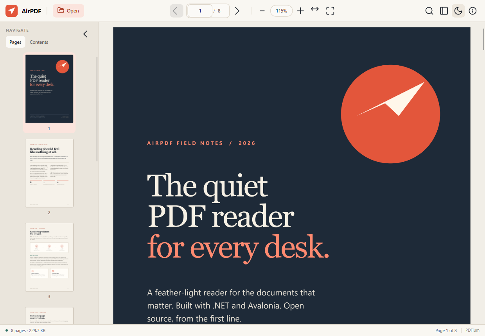
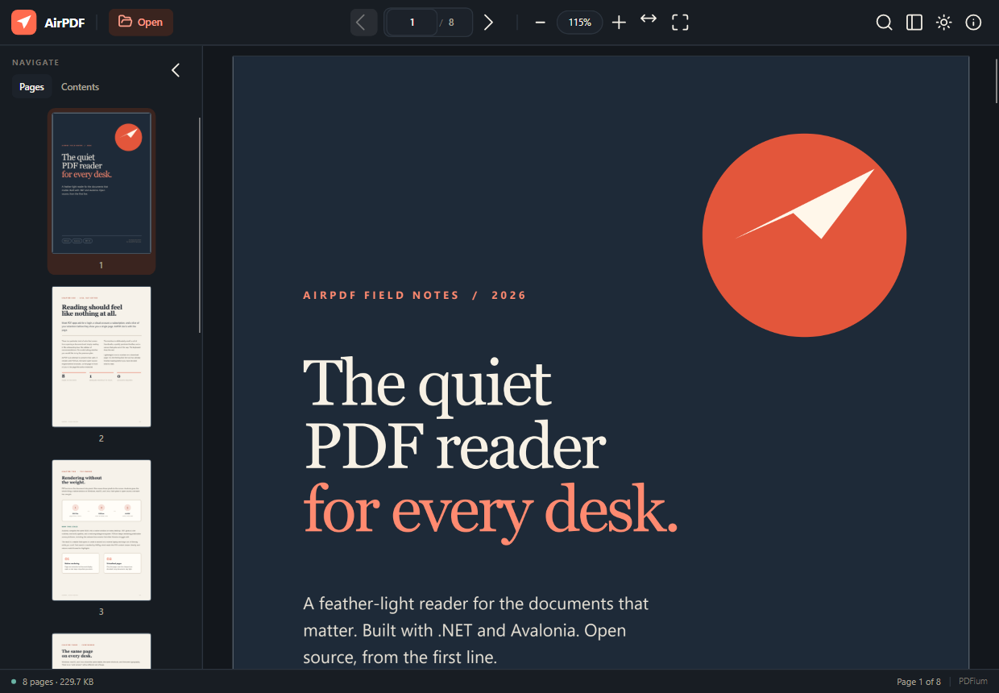
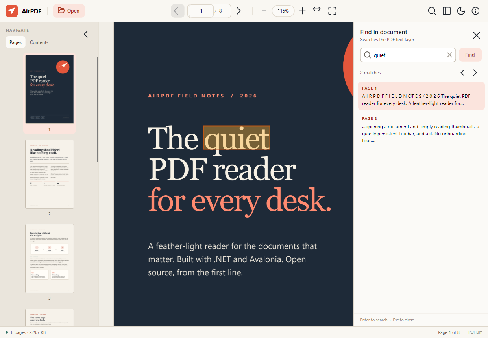

<p align="center">
  
</p>

<h1 align="center">AirPDF</h1>

<p align="center">
  A feather-light, cross-platform PDF reader built with .NET and Avalonia.
</p>

<p align="center">
  
  
  
  
</p>

AirPDF opens PDFs quickly, renders them natively, and stays out of the way. It
has no account, no cloud, no telemetry, and no web view. The whole reader is a
small .NET application with a hand-built Avalonia interface.

> **Status:** 0.1 preview. The reading core is stable and tested; annotations,
> printing, and text selection are not implemented yet. See the
> [roadmap](#roadmap).

---

## Screenshots

| Reading, light | Reading, dark |
| --- | --- |
|  |  |



## Features

- **Native PDFium rendering** at the exact display scale, with high-DPI support.
- **Continuous, virtualized pages** — only pages near the viewport are decoded.
- **Thumbnail rail and document outline** for fast navigation.
- **Full-text search** with page-grouped results and in-page match highlights.
- **Zoom** with fit width, fit page, actual size, presets, and `Ctrl` + wheel.
- **Password-protected PDFs** with a proper unlock prompt.
- **Light and dark themes**, following the system on first launch.
- **Drag and drop**, command-line opening, and a recent-files shelf.
- **Keyboard-first navigation** and a quiet, information-dense status bar.
- **Zero network access** from the reading path.

## Tech stack

| Layer | Choice | Why |
| --- | --- | --- |
| Runtime | .NET 10 (LTS) | One modern runtime for Windows, macOS, and Linux. |
| UI | Avalonia 11 | Native desktop windows from a single XAML codebase. |
| Rendering | PDFium via PDFtoImage | The same open-source engine used by browsers. |
| Raster transport | SkiaSharp | Fast, predictable pixel handling. |
| Text layer | PdfPig | Managed PDF text extraction, search, and match rectangles. |
| MVVM | CommunityToolkit.Mvvm | Small, source-generated, no framework lock-in. |

## Requirements

- [.NET 10 SDK](https://dotnet.microsoft.com/download) for building.
- Windows 10/11, macOS 13+, or a modern Linux desktop (X11 or Wayland).
- On Linux, the usual Avalonia desktop dependencies (X11/Wayland, fontconfig,
  and OpenGL or a software renderer) must be installed.

The published builds are self-contained; end users do not need .NET installed.

## Run from source

```bash
git clone https://github.com/<your-account>/AirPDF.git
cd AirPDF
dotnet run --project src/AirPdf.App
```

Open a PDF with the **Open** button, drag one onto the window, or pass a path:

```bash
dotnet run --project src/AirPdf.App -- /path/to/document.pdf
```

## Build and test

```bash
dotnet restore AirPdf.sln
dotnet build AirPdf.sln -c Release
dotnet test tests/AirPdf.Core.Tests/AirPdf.Core.Tests.csproj -c Release
```

The tests use `tests/Assets/sample.pdf`, an eight-page document that exercises
Latin and Chinese text, mixed typography, and search geometry.

## Publish

Framework-dependent build:

```bash
dotnet publish src/AirPdf.App -c Release -r linux-x64 --self-contained false
```

Self-contained single file:

```bash
dotnet publish src/AirPdf.App -c Release -r win-x64 \
  --self-contained true \
  -p:PublishSingleFile=true \
  -p:IncludeNativeLibrariesForSelfExtract=true \
  -p:EnableCompressionInSingleFile=true
```

Supported runtime identifiers include `win-x64`, `win-arm64`, `linux-x64`,
`linux-arm64`, `osx-x64`, and `osx-arm64`.

> Release binaries are currently unsigned. Windows SmartScreen and macOS
> Gatekeeper may ask for confirmation until signing is added.

## Keyboard shortcuts

| Shortcut | Action |
| --- | --- |
| `Ctrl+O` / `Cmd+O` | Open a PDF |
| `Ctrl+W` / `Cmd+W` | Close the document |
| `Ctrl+F` / `Cmd+F` | Find in document |
| `Enter` | Jump to the typed page, or run a search |
| `Esc` | Close search, dismiss an error, or leave full screen |
| `Ctrl++` / `Ctrl+-` | Zoom in / out |
| `Ctrl+0` | Fit page |
| `Ctrl+1` | Actual size |
| `Ctrl+2` | Fit width |
| `Ctrl` + wheel | Zoom |
| `F11` | Toggle full screen |
| `Page Up` / `Page Down` | Scroll the document |

## Architecture

```
┌─────────────────────────────┐
│ AirPdf.App (Avalonia)       │
│  views · view models        │
│  bitmap conversion · input  │
└──────────────┬──────────────┘
               │
┌──────────────▼──────────────┐
│ AirPdf.Core                 │
│  PdfDocumentService         │  PDFium (PDFtoImage)
│  PdfSearchService           │  PdfPig
│  SettingsService            │  JSON in the user profile
└─────────────────────────────┘
```

- `AirPdf.Core` has no Avalonia dependency and can be reused by a CLI, tests,
  or another front end.
- PDFium is single-threaded by design, so all render calls are serialized
  through one process-wide gate.
- Pages are rendered to `WriteableBitmap` objects and evicted when they move
  outside a small window around the current page.
- The page list is a virtualizing `ListBox` with a custom template; the scroll
  position drives current-page detection and thumbnail selection.
- Search reads the PDF text layer once, groups matches by page, and maps word
  bounding boxes back to normalized overlay rectangles.

More detail: [docs/ARCHITECTURE.md](docs/ARCHITECTURE.md).

## Project layout

```
src/
  AirPdf.Core/          PDF services, models, settings
  AirPdf.App/           Avalonia desktop application
tests/
  AirPdf.Core.Tests/    Open, render, search, and failure tests
  Assets/               Reproducible sample PDF and its HTML source
docs/                   Screenshots and architecture notes
```

## Limitations

- Pages are rasterized; text is not selectable yet.
- No annotations, form filling, printing, or PDF editing.
- Search highlights are hidden on pages with a non-zero `/Rotate` value; the
  results themselves still work.
- One document per window; no tabs.
- No installers or code signing in the repository yet.
- Mobile and browser targets are out of scope for the desktop reader.

## Roadmap

- [ ] Text selection and copy
- [ ] Native printing and "Save a copy"
- [ ] Per-document bookmarks and remembered reading position
- [ ] Annotations (highlight, ink, notes)
- [ ] Tabs and multi-window support
- [ ] Signed installers and automatic updates
- [ ] Full localization (the UI is English today)
- [ ] Rotated-page search highlights

Contributions and issue reports are welcome. If you want to pick up a roadmap
item, open an issue first so we can keep the design coherent.

## Contributing

Read [CONTRIBUTING.md](CONTRIBUTING.md) before opening a pull request. The
project follows the [Contributor Covenant](CODE_OF_CONDUCT.md). Security issues
should follow [SECURITY.md](SECURITY.md), not the public issue tracker.

## License

AirPDF is released under the [MIT License](LICENSE). Third-party components and
their licenses are listed in [THIRD-PARTY-NOTICES.md](THIRD-PARTY-NOTICES.md).

---

<sub>Also available in [简体中文](README.zh-CN.md).</sub>
