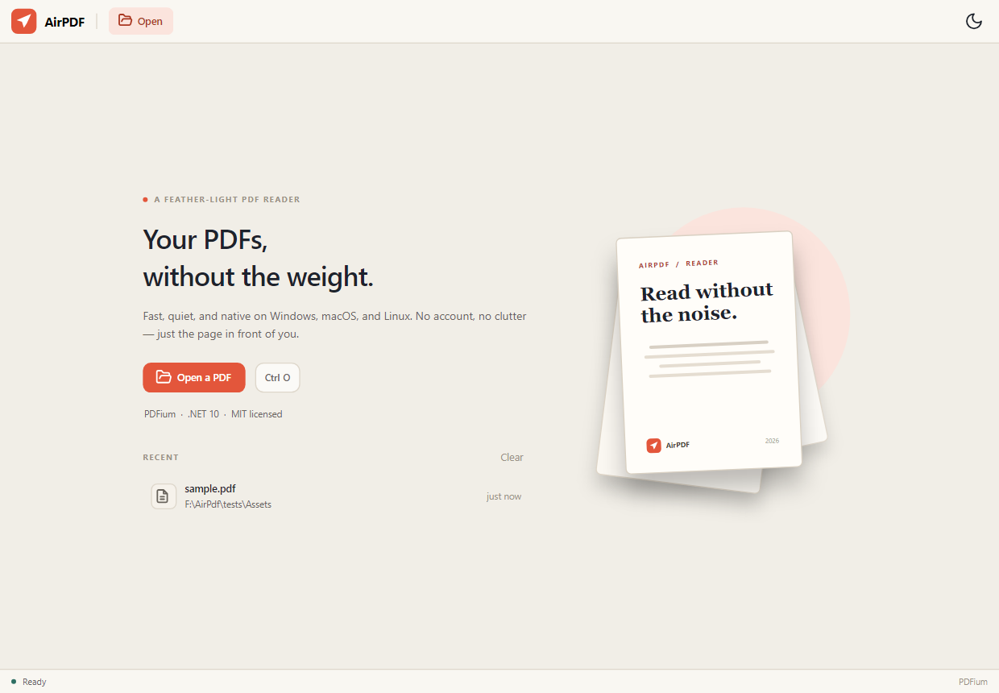
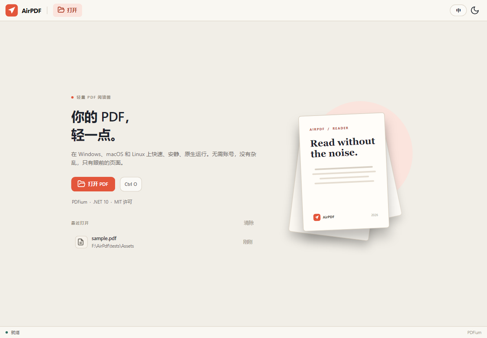

<p align="center">
  <a href="README.md">English</a> &nbsp;·&nbsp; <strong>简体中文</strong>
</p>

<p align="center">
  
</p>

<h1 align="center">AirPDF</h1>

<p align="center">一款轻量、跨平台的 PDF 阅读器，使用 .NET 与 Avalonia 构建。</p>

<p align="center">
  
  
  
</p>

AirPDF 打开得快、渲染得稳，然后安静地退到页面后面。没有账号，没有云端，没有遥测，
也没有内嵌浏览器。整个阅读器就是一个小的 .NET 应用，界面用 Avalonia 手写。

> **状态：** 0.2 预览版。阅读核心已经可用并有测试覆盖；批注、打印尚未实现。



## 功能

- **PDFium 原生渲染**，按实际显示比例解码，支持高 DPI。
- **连续滚动 + 页面虚拟化**，只渲染视口附近的页面。
- **缩略图侧栏与文档目录**，长文档也能快速跳转。
- **全文搜索**，结果按页分组，并在页面上绘制匹配框。
- **文本选择与复制**：拖动选择单词或跨页文本，双击选词，`Ctrl+A` 全选，
  `Ctrl+C` 复制。
- **自动记忆阅读位置**：记住页码和页内位置，下次打开同一文档时自动恢复。
- **按文档记忆缩放**：适合宽度、适合页面，或精确比例，下次打开原样恢复。
- **缩放**：适合宽度、适合页面、实际大小、预设比例、`Ctrl` + 滚轮。
- **加密 PDF**：会弹出密码输入框。
- **浅色 / 深色 / 高对比度主题**，首次启动跟随系统。
- **状态栏**显示页码位置与阅读进度百分比。
- **超链接**：文档内跳转会跳到目标页，`http`/`https`/`mailto` 链接交给系统打开，
  鼠标移上去变成手型。
- **多窗口**（`Ctrl+N`，或把当前文件在新窗口中打开），各窗口共享同一份设置、
  主题和语言。
- **标签页**：`Ctrl+T` 在同一窗口里再开一份文档，每个标签各自保留缩放、滚动位置、
  搜索结果和阅读位置。
- **返回上一个位置**：目录、缩略图、搜索或页码跳转后，`Alt+Left` 回到跳转前。
- **右键菜单**：复制选中内容、全选、打开文件所在文件夹。
- **无障碍**：工具栏按钮、输入框和列表都带有供屏幕阅读器识别的名称。
- **默认英文，可切换简体中文**，工具栏或 `Ctrl+Shift+L` 即时切换。
- **拖放打开**、命令行打开、最近文件列表。
- **安装版自动更新**：后台检查并下载新版本，状态栏提示重启更新。
- **键盘操作**，以及一条克制的状态栏。
- **阅读路径不产生网络请求**；只有安装版检查更新时会访问 GitHub。

## 技术栈

| 层 | 选择 | 原因 |
| --- | --- | --- |
| 运行时 | .NET 10 (LTS) | 一个现代运行时覆盖三大桌面平台。 |
| 界面 | Avalonia 11 | 一套 XAML 代码生成原生桌面窗口。 |
| 渲染 | PDFium | 浏览器同款开源 PDF 引擎；阅读期间常驻一个文档句柄。 |
| 位图传输 | SkiaSharp | 快速、可控的像素处理。 |
| 文本层 | PdfPig | 纯托管文本提取、搜索与匹配坐标。 |
| MVVM | CommunityToolkit.Mvvm | 小而克制的源生成 MVVM。 |

## 从源码运行

需要 [.NET 10 SDK](https://dotnet.microsoft.com/download)。Windows 10/11、
macOS 13+，或现代 Linux 桌面（X11 / Wayland）均可。

```bash
git clone https://github.com/RyzenWang/AirPDF.git
cd AirPDF
dotnet run --project src/AirPdf.App
```

也可以通过按钮、拖放，或命令行参数打开 PDF：

```bash
dotnet run --project src/AirPdf.App -- /path/to/document.pdf
```

## 构建与测试

```bash
dotnet restore AirPdf.sln
dotnet build AirPdf.sln -c Release
dotnet test AirPdf.sln -c Release
```

测试使用 `tests/Assets/sample.pdf`，一份八页的示例文档，覆盖英文、中文、
混合排版和搜索坐标。`AirPdf.App.Tests` 还包含 Headless Avalonia 测试，覆盖
打开、搜索、选择、缩放、语言切换和阅读位置恢复。

## 发布

```bash
dotnet publish src/AirPdf.App -c Release -r win-x64 \
  --self-contained true \
  -p:PublishSingleFile=true \
  -p:IncludeNativeLibrariesForSelfExtract=true \
  -p:EnableCompressionInSingleFile=true
```

支持 `win-x64`、`win-arm64`、`linux-x64`、`linux-arm64`、`osx-x64`、
`osx-arm64`。

### 安装器与自动更新

Tag 发布会使用 [Velopack](https://velopack.io/) 生成：

- Windows x64：`AirPDF-win-Setup.exe` 安装器与便携 zip
- macOS arm64 / x64：`AirPDF-osx-*.pkg` 安装器与便携包
- Linux x64：便携 `.tar.gz`

安装后的 Windows / macOS 版本会检查 GitHub 上的稳定版，后台下载并显示
“重启以更新”。便携版和源码运行不会自动更新。

工作流包含可选的 Windows 代码签名以及 macOS 签名 / 公证步骤。所需 Secrets
和发布流程见 [docs/DISTRIBUTION.md](docs/DISTRIBUTION.md)。未配置签名时仍会
生成未签名安装包，Windows SmartScreen 和 macOS Gatekeeper 可能要求确认。

## 快捷键

| 快捷键 | 操作 |
| --- | --- |
| `Ctrl+O` / `Cmd+O` | 打开 PDF |
| `Ctrl+W` / `Cmd+W` | 关闭文档 |
| `Ctrl+N` / `Cmd+N` | 新建窗口 |
| `Ctrl+T` / `Cmd+T` | 新建标签页 |
| `Ctrl+Tab` / `Ctrl+Shift+Tab` | 下一个 / 上一个标签页 |
| `Ctrl+F` / `Cmd+F` | 在文档中查找 |
| `F3` / `Shift+F3` | 下一个 / 上一个匹配 |
| `Alt+Left` | 返回上一个位置 |
| 在文字上拖动 | 选择单词 |
| 双击文字 | 选择一个单词 |
| `Ctrl+C` / `Cmd+C` | 复制选中文本 |
| `Ctrl+A` / `Cmd+A` | 全选文档文本 |
| `Enter` | 跳转到输入的页码，或执行搜索 |
| `Esc` | 关闭搜索 / 忽略错误 / 退出全屏 |
| `Ctrl++` / `Ctrl+-` | 放大 / 缩小 |
| `Ctrl+0` | 适合页面 |
| `Ctrl+1` | 实际大小 |
| `Ctrl+2` | 适合宽度 |
| `Ctrl` + 滚轮 | 缩放 |
| `Ctrl+Shift+L` | 切换英文 / 简体中文 |
| `F11` | 全屏 |
| `Page Up` / `Page Down` | 滚动页面 |

在页面区域点击右键，可以复制选中内容、全选文档，或打开文件所在文件夹。

## 项目结构

```
src/
  AirPdf.Core/          PDF 服务、模型、设置
  AirPdf.App/           Avalonia 桌面应用
tests/
  AirPdf.Core.Tests/    打开、渲染、搜索、错误处理测试
  AirPdf.App.Tests/     Headless 视图模型与页面布局测试
  Assets/               可复现的示例 PDF 与 HTML 源文件
docs/                   截图与架构说明
```

`AirPdf.Core` 不依赖 Avalonia，可以被 CLI、测试或其他前端复用。PDFium 不是
线程安全的，所以所有渲染调用在一个进程级信号量下串行执行。页面位图会按当前页
附近的小窗口淘汰，避免长文档占用过多内存。

## 已知限制

- 文本选择以单词为单位，暂未精确到字符。
- 带 `/Rotate` 的页面暂不支持文本选择。
- 暂无批注、表单填写、打印或 PDF 编辑。
- 带 `/Rotate` 的页面暂不显示搜索高亮，但搜索结果仍可用。
- 带 `/Rotate` 的页面上的链接不可点击；链接只跟随 `http`、`https` 和 `mailto`。
- 每个标签页一个文档；`Ctrl+W` 关闭标签页（只剩一个时关闭其文档，窗口留在欢迎页）。
- 只有配置维护者签名密钥后，发布包才会签名；未签名版本可能触发平台警告。
- 移动端与浏览器端不在本项目范围内。

## 路线图

- [x] PDF 超链接与文档内跳转
- [ ] 原生打印与“保存副本”
- [ ] 单文档书签
- [ ] 旋转页面的搜索高亮
- [ ] 批注（高亮、墨迹、便签）
- [x] 多窗口
- [x] 标签页
- [ ] 更多界面语言（当前已有英文与简体中文）
- [ ] 配置正式 Windows 签名与 Apple 公证凭据
- [ ] 缩放、搜索、语言切换和更新的 UI / 端到端测试

## 参与贡献

请先阅读 [CONTRIBUTING.md](CONTRIBUTING.md)。项目遵循
[Contributor Covenant](CODE_OF_CONDUCT.md)。安全问题请按
[SECURITY.md](SECURITY.md) 私下报告。

## 许可证

AirPDF 使用 [MIT License](LICENSE)。第三方组件与许可证见
[THIRD-PARTY-NOTICES.md](THIRD-PARTY-NOTICES.md)。

---

<sub>English: [README.md](README.md)</sub>
