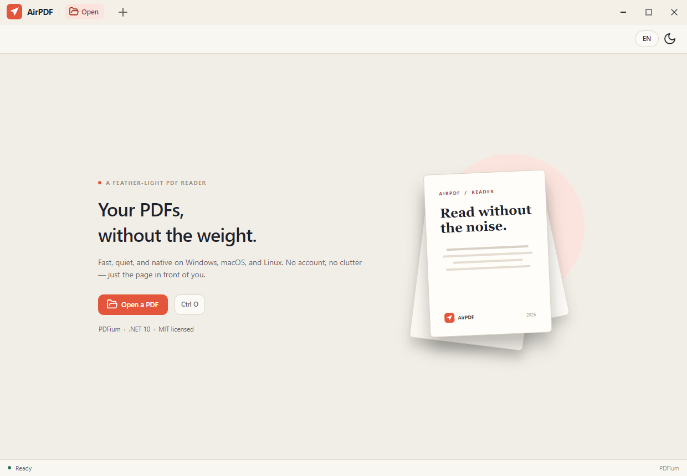
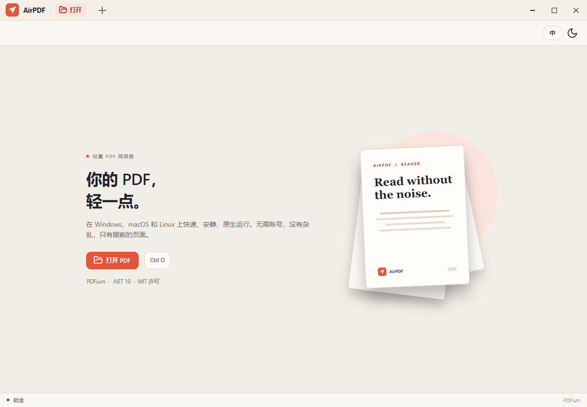

<p align="center">
  <a href="README.md">English</a> &nbsp;·&nbsp; <strong>简体中文</strong>
</p>

<p align="center">
  
</p>

<h1 align="center">AirPDF</h1>

<p align="center">一款轻量、跨平台的 PDF 阅读器，使用 .NET 与 Avalonia 构建。</p>

<p align="center">
  <a href="https://apps.microsoft.com/detail/9pnsx3223qh1"><strong>Microsoft Store</strong></a>
  &nbsp;·&nbsp;
  <a href="https://github.com/RyzenWang/AirPDF/releases/latest">最新发布</a>
</p>

<p align="center">
  
  
  
</p>

AirPDF 打开得快、渲染得稳，然后安静地退到页面后面。没有账号，没有云端，没有遥测，
也没有内嵌浏览器。整个阅读器就是一个小的 .NET 应用，界面用 Avalonia 手写。

> **状态：** 0.6.0。Windows 版可从 [Microsoft Store](https://apps.microsoft.com/detail/9pnsx3223qh1)
> 和 [GitHub Releases](https://github.com/RyzenWang/AirPDF/releases/latest) 获取；macOS 与 Linux
> 提供便携包。商店版本可能晚于 GitHub 发布。高亮、墨迹、便签、书签、标签页、Windows 自定义
> 标题栏、撤销/重做与保存均已可用；打印尚未实现。见[路线图](#路线图)。



Windows 截图展示 0.6 的标题栏：文档标签和窗口按钮共享顶部一行。macOS 与 Linux 保留原生窗口边框，
标签栏位于其下。

## 功能

- **PDFium 原生渲染**，按实际显示比例解码，支持高 DPI。
- **连续滚动 + 页面虚拟化**，只渲染视口附近的页面。可见页面优先于缩略图渲染，页面位图按数量和
  内存上限淘汰，关闭标签页时 PDFium 会话在 UI 线程之外释放。
- **Windows 标题栏即标签栏**：44px 顶部栏同时承载品牌、打开、文档标签和最小化/最大化/关闭；
  下方工具栏不变。拖动空白区域移动窗口，双击最大化，悬停最大化按钮可使用 Windows 11
  Snap Layouts。右键空白标题栏或按 `Alt+Space` 打开原生窗口菜单；窗口非活动时按钮自动淡化。
  macOS 与 Linux 保留原生窗口边框。
- **页码导航靠左**：上一页 / 下一页和当前页输入框位于工具栏最左侧，与缩略图栏对齐；
  标注与缩放工具组仍在中间。
- **缩略图侧栏与文档目录**，长文档也能快速跳转。
- **全文搜索**，结果按页分组，在页面上绘制匹配框，并在扫描长文档时显示进度。
- **文本选择与复制**：拖动选择单词或跨页文本，双击选词，`Ctrl+A` 全选（最多 1,000 页），
  `Ctrl+C` 复制。
- **自动记忆阅读位置**：记住页码和页内位置，下次打开同一文档时自动恢复。
- **按文档记忆缩放**：适合宽度、适合页面，或精确比例，下次打开原样恢复。
- **缩放**：适合宽度、适合页面、实际大小、预设比例、`Ctrl` + 滚轮。
- **加密 PDF**：会弹出密码输入框。
- **浅色 / 深色 / 高对比度主题**，首次启动跟随系统。
- **状态栏**显示页码位置与阅读进度百分比。
- **高亮、墨迹与便签**：选中文本按 `Ctrl+Shift+H` 高亮；或在右键菜单的「高亮」里选颜色，选中即按该颜色高亮。
  `Ctrl+Shift+K` 或笔按钮开启自由绘制，笔旁的箭头打开墨迹颜色与粗细，粗细会按实际笔迹预览。便签也在右键菜单里，高亮同样可从那里移除；
  每次标注修改都能撤销与重做（工具栏按钮或 `Ctrl+Z` / `Ctrl+Y`，保留最近 100 步），`Ctrl+S` 直接保存到当前文档。
- **单文档书签**：`Ctrl+D` 标记当前位置，侧栏新增书签页按文件保存；双击可重命名，可拖拽排序，欢迎页还会汇总所有文档的书签，点一下直接跳回去。
- **超链接**：文档内跳转会跳到目标页，`http`/`https`/`mailto` 链接交给系统打开，
  鼠标移上去变成手型。
- **多窗口**（`Ctrl+N`，或把当前文件在新窗口中打开），各窗口共享同一份设置、
  主题和语言。
- **系统托盘**：托盘图标可恢复隐藏的窗口；菜单可以隐藏所有窗口、新建窗口或退出。
  关闭窗口仍会退出应用，选择「隐藏到托盘」可保持文档继续打开。Linux 上是否显示
  托盘图标取决于桌面环境是否支持 StatusNotifier / AppIndicator。
- **标签页保留完整文档状态**：`Ctrl+T` 在同一窗口里再开一份文档，每个标签各自保留缩放、
  滚动位置、搜索结果和阅读位置。当前标签是暖白胶囊；标签过多时标签栏横向滚动，`+` 先跟随
  最后一个标签，溢出后固定在可见区域右缘。品牌区域就是主页入口，不再单独占用一个标签。
- **使用 NativeAOT**：所有发布版均提前编译，窗口出现时间从数秒降到一秒以内。
- **返回上一个位置**：目录、缩略图、搜索或页码跳转后，`Alt+Left` 回到跳转前。
- **右键菜单**：复制选中内容、全选、打开文件所在文件夹。
- **无障碍**：工具栏按钮、输入框和列表都带有供屏幕阅读器识别的名称。
- **默认英文，可切换简体中文**，工具栏或 `Ctrl+Shift+L` 即时切换。
- **拖放打开**、命令行打开、最近文件列表。
- **安装版自动更新**：Velopack 安装版会检查 GitHub、后台下载并提示重启；Microsoft Store
  版本走商店更新；便携版和源码运行不自动更新。
- **键盘操作**，以及一条克制的状态栏。
- **阅读路径不产生网络请求**；只有 Velopack 安装版检查更新时会访问 GitHub。

## 技术栈

| 层 | 选择 | 原因 |
| --- | --- | --- |
| 运行时 | .NET 10 (LTS) | 一个现代运行时覆盖三大桌面平台。 |
| 界面 | Avalonia 11 | 一套 XAML 代码生成原生桌面窗口。 |
| 窗口 | Avalonia + `Win32Properties` | Windows 标签栏兼作自定义标题栏；`HTMAXBUTTON` 恢复 Windows 11 Snap Layouts。macOS / Linux 保留原生窗口装饰。 |
| 渲染 | PDFium | 浏览器同款开源 PDF 引擎；阅读期间常驻一个文档句柄。 |
| 位图传输 | SkiaSharp | 快速、可控的像素处理。 |
| 文本层 | PDFium（`FPDFText_*`） | 由渲染同一引擎按阅读顺序给出字符，搜索、选择与旋转页和实际绘制一致；PdfPig 负责元数据与目录。 |
| MVVM | CommunityToolkit.Mvvm | 小而克制的源生成 MVVM。 |
| 编译方式 | NativeAOT（Windows、Linux、macOS） | 启动时无 JIT：Windows 实测首窗 0.7 秒，对比 5.0 秒。 |

## 从源码运行

需要 [.NET 10 SDK](https://dotnet.microsoft.com/download)。Windows 10/11、
macOS 13+，或现代 Linux 桌面（X11 / Wayland）均可。Windows 11 支持从自定义最大化按钮
唤起 Snap Layouts；Windows 10 使用同样的自定义标题栏，但没有 Snap 弹层。

```bash
git clone https://github.com/RyzenWang/AirPDF.git
cd AirPDF
dotnet run --project src/AirPdf.App
```

也可以通过按钮、拖放，或命令行参数打开 PDF：

```bash
dotnet run --project src/AirPdf.App -- /path/to/document.pdf
```

## 构建与测试

```bash
dotnet restore AirPdf.sln
dotnet build AirPdf.sln -c Release
dotnet test AirPdf.sln -c Release
```

Linux 构建在 Ubuntu 22.04 上产出，因此需要 glibc 2.35 或更高（Ubuntu 22.04+、Debian 12+）。
NativeAOT 会链接构建机的 glibc，更老的发行版无法启动该二进制。
发布 NativeAOT 版本还需要 C++ 工具链：Windows 上需要 MSVC 生成工具与 Windows SDK，
macOS 上需要 Xcode，Linux 上需要 clang。普通的 `dotnet build` 不需要。

测试目前共 **222 个**（Core 103 个，App 119 个）。测试使用 `tests/Assets/sample.pdf`，
一份八页的示例文档，覆盖英文、中文、混合排版和搜索坐标。`AirPdf.App.Tests` 还包含
Headless Avalonia 测试，覆盖 XAML 与标签栏、打开、搜索、选择、缩放、语言切换、
阅读位置恢复，以及 Windows Snap Layouts 的 hit-test 标记。

## 发布

```bash
dotnet publish src/AirPdf.App -c Release -r win-x64 \
  --self-contained true \
  -p:PublishSingleFile=true \
  -p:IncludeNativeLibrariesForSelfExtract=true \
  -p:EnableCompressionInSingleFile=true
```

NativeAOT，也是所有发布版使用的方式：

```bash
dotnet publish src/AirPdf.App -c Release -r win-x64 `
  -p:PublishAot=true `
  -p:StripSymbols=true
```

支持 `win-x64`、`win-arm64`、`linux-x64`、`linux-arm64`、`osx-x64`、
`osx-arm64`。

### 安装包与自动更新

Tag 发布会使用 [Velopack](https://velopack.io/) 生成：

- **Windows x64：[Microsoft Store](https://apps.microsoft.com/detail/9pnsx3223qh1)** —— 推荐，更新由商店推送
- Windows x64 便携版：`AirPDF-win-Portable.zip`，解压后直接运行 `AirPdf.exe`
- macOS arm64 / x64：`AirPDF-osx-*-Portable.zip`，解压后把 `AirPDF.app` 拖进「应用程序」
- Linux x64：便携 `.tar.gz`

**安装器暂不提供。** 当前版本未签名，`Setup.exe` 和 `.pkg` 首次启动会被 SmartScreen 与
Gatekeeper 拦下，用户会以为阅读器本身有问题。便携包照常提供，首次启动可能仍需在 Windows
点「更多信息 → 仍要运行」，或在 macOS 上右键 →「打开」。配置好签名证书后会恢复提供安装器。

Velopack 安装版会检查 GitHub 上的稳定版，后台下载并显示“重启以更新”。
Microsoft Store 版本由商店更新；便携版和源码运行不会自动更新。

工作流包含可选的 Windows 代码签名以及 macOS 签名 / 公证步骤。证书获取与
Secrets 配置见 [docs/SIGNING.md](docs/SIGNING.md)，发布流程见
[docs/DISTRIBUTION.md](docs/DISTRIBUTION.md)。

`packaging/signing/Set-SigningSecrets.ps1` 会校验证书并上传为 Secret。
**Signing check** 工作流可以在不发布任何版本的前提下验证配置：

```bash
gh workflow run signing-check.yml --repo RyzenWang/AirPDF
```

未配置签名时仍会生成未签名安装包，Windows SmartScreen 和 macOS Gatekeeper
可能要求确认。

## 快捷键

| 快捷键 | 操作 |
| --- | --- |
| `Ctrl+O` / `Cmd+O` | 打开 PDF |
| `Ctrl+W` / `Cmd+W` | 关闭标签页（有未保存标注时先询问） |
| `Ctrl+N` / `Cmd+N` | 新建窗口 |
| `Ctrl+T` / `Cmd+T` | 新建标签页 |
| `Ctrl+Tab` / `Ctrl+Shift+Tab` | 下一个 / 上一个标签页 |
| `Ctrl+F` / `Cmd+F` | 在文档中查找 |
| `Ctrl+D` / `Cmd+D` | 在当前位置添加书签 |
| `Ctrl+Shift+H` / `Cmd+Shift+H` | 高亮选中的文本 |
| `Ctrl+Shift+K` / `Cmd+Shift+K` | 开关自由绘制（墨迹） |
| `Ctrl+S` / `Cmd+S` | 保存当前文档（含高亮） |
| `Ctrl+Shift+S` / `Cmd+Shift+S` | 另存为… |
| `Ctrl+Z` / `Cmd+Z` | 撤销上一次标注修改（保留最近 100 步） |
| `Ctrl+Y` / `Cmd+Y` | 重做 |
| `F3` / `Shift+F3` | 下一个 / 上一个匹配 |
| `Alt+Left` | 返回上一个位置 |
| `Alt+Space` | 打开窗口系统菜单（Windows） |
| 在文字上拖动 | 选择单词 |
| 双击文字 | 选择一个单词 |
| `Ctrl+C` / `Cmd+C` | 复制选中文本 |
| `Ctrl+A` / `Cmd+A` | 全选文档文本（最多 1,000 页） |
| `Enter` | 跳转到输入的页码，或执行搜索 |
| `Esc` | 退出绘制/擦拭模式、取消选择、关闭搜索、忽略错误、退出全屏 |
| `Ctrl++` / `Ctrl+-` | 放大 / 缩小 |
| `Ctrl+0` | 适合页面 |
| `Ctrl+1` | 实际大小 |
| `Ctrl+2` | 适合宽度 |
| `Ctrl` + 滚轮 | 缩放 |
| `Ctrl+Shift+L` | 切换英文 / 简体中文 |
| `F11` | 全屏 |
| `Page Up` / `Page Down` | 滚动页面 |

在页面区域点击右键，可以复制选中内容、全选文档，或打开文件所在文件夹。

## 项目结构

```
src/
  AirPdf.Core/          PDF 服务、模型、设置
  AirPdf.App/           Avalonia 桌面应用
tests/
  AirPdf.Core.Tests/    打开、渲染、搜索、错误处理测试
  AirPdf.App.Tests/     Headless 视图模型与页面布局测试
  Assets/               可复现的示例 PDF 与 HTML 源文件
docs/                   截图与架构说明
```

`AirPdf.Core` 不依赖 Avalonia，可以被 CLI、测试或其他前端复用。PDFium 不是
线程安全的，所以所有渲染调用在一个进程级信号量下串行执行。页面位图会按当前页
附近的小窗口淘汰，避免长文档占用过多内存。

Windows 上使用 `SystemDecorations.BorderOnly` 和扩展客户区替换系统标题栏；
最大化按钮通过 `Win32Properties` 暴露为 `HTMAXBUTTON`，由一个小型 `WM_NCMOUSEMOVE`
钩子维护 hover 状态，Windows 11 负责显示 Snap Layouts。右键标题栏空白处或按
`Alt+Space` 时，通过 `GetSystemMenu` / `TrackPopupMenu` 打开原生系统菜单；
`Activated` / `Deactivated` 事件控制窗口按钮的淡化。其他平台不启用这层自定义窗口。

## 已知限制

- 文本选择以单词为单位，暂未精确到字符。
- 暂无表单填写、打印或 PDF 文字编辑。
- 链接只跟随 `http`、`https` 和 `mailto`；`Launch` 和远程 `GoTo` 动作会被忽略，
  文档无法借此启动程序。
- 标签页就是文档会话；品牌区域是主页入口，不是单独标签。关闭最后一个文档标签会回到主页，
  `Ctrl+W` 会先确认是否丢弃未保存的标注。
- Windows 11 支持 Snap Layouts；Windows 10 只有同样的自定义按钮，没有 Snap 弹层。
- 自定义标题栏目前只在 Windows 启用；macOS 与 Linux 保留原生窗口装饰，标签栏位于其下。
- 只有配置维护者签名密钥后，发布包才会签名；未签名版本可能触发平台警告。
- 移动端与浏览器端不在本项目范围内。

## 路线图

- [x] PDF 超链接与文档内跳转
- [ ] 原生打印与“保存副本”
- [x] 单文档书签
- [x] 旋转页（链接、搜索高亮、文本选择）
- [x] 高亮批注，配合「保存副本」
- [x] 墨迹与便签批注
- [x] 多窗口
- [x] 标签页
- [x] 标签栏 / 标题栏合一，并支持 Windows 11 Snap Layouts
- [x] Windows 标题栏系统菜单与非活动窗口按钮状态
- [ ] 更多界面语言（当前已有英文与简体中文）
- [ ] 配置正式 Windows 签名与 Apple 公证凭据
- [x] NativeAOT（Windows、Linux、macOS 均已使用）
- [x] 缩放、搜索、语言切换和更新的 UI / 端到端测试

## 参与贡献

请先阅读 [CONTRIBUTING.md](CONTRIBUTING.md)。项目遵循
[Contributor Covenant](CODE_OF_CONDUCT.md)。安全问题请按
[SECURITY.md](SECURITY.md) 私下报告。

## 许可证

AirPDF 使用 [MIT License](LICENSE)。第三方组件与许可证见
[THIRD-PARTY-NOTICES.md](THIRD-PARTY-NOTICES.md)。

---

<sub>English: [README.md](README.md)</sub>
